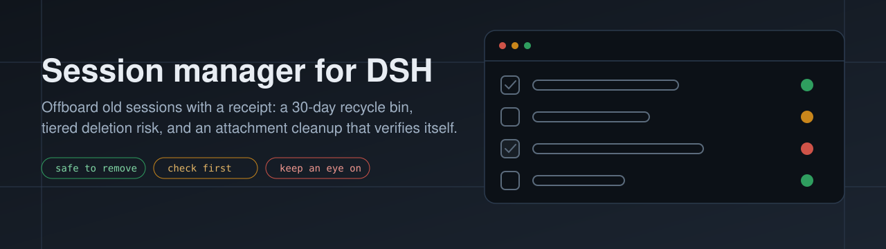
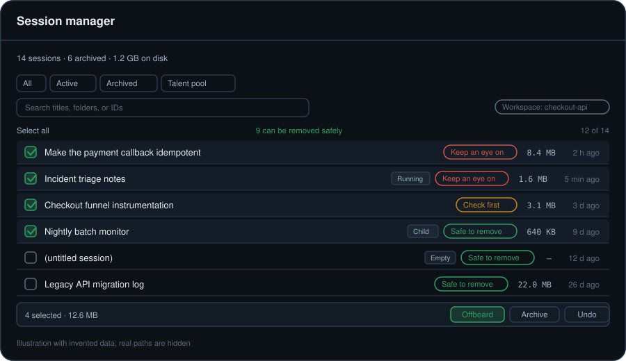
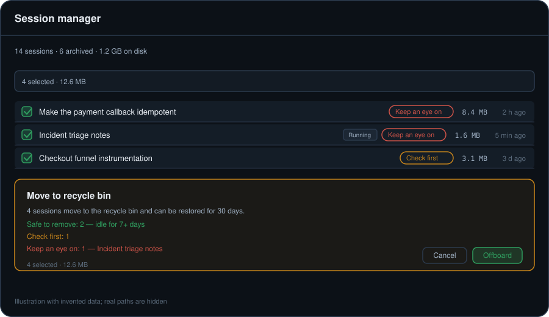
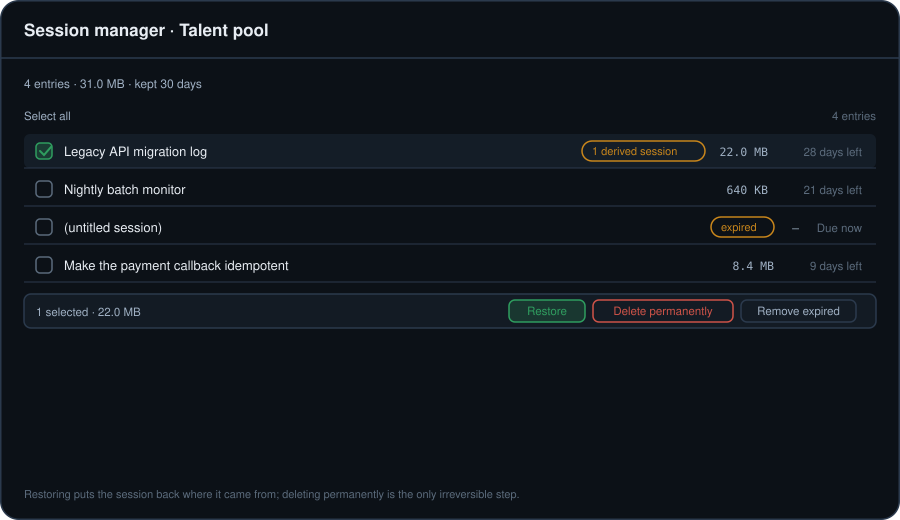

<p align="center"></p>

<p align="center">
  
  
  
  
</p>

<p align="center"><a href="README.md">简体中文</a> · <strong>English</strong> · <a href="CHANGELOG.md">Changelog</a> · <a href="DESIGN.md">Design</a></p>

---

## The problem: clearing history has always been a coin flip

- **You don't dare.** Hundreds of sessions pile up, nobody knows which one still matters, and deleting the wrong one takes something live with it — so the folder keeps growing and everyone looks away.
- **Deleting hurts.** The usual tool removes a session root and branch: images and files go missing, a conversation you still wanted stops working, and nothing comes back.
- **Nobody can explain it later.** Three months on, someone asks who removed last week's sessions and why. The honest answer is "I tidied up".

## What this does instead

It turns removal into an **operation with a receipt**, not a reflex:

1. **Judge first.** Every session carries a deletion-risk verdict with the reasons that produced it (pinned, running, has derived sessions, active within 24 h, oversized log, long idle). The policy is a versioned data file, not magic numbers scattered through UI code.
2. **Destroy nothing by default.** Deleting means moving into a 30-day recycle bin that can be restored with one click; the only irreversible step lives in the bin view, on its own.
3. **Guard the irreversible step.** A session other sessions still derive from is refused (`has-descendants`) unless you confirm; every move is verified and rolled back when it does not hold.
4. **Prove the cleanup.** The attachment cleanup rescans the corpus and confirms every referenced object is still on disk, then records that proof — with the policy version — in an audit log.

> **Clearing history should be a routine with evidence, not a feeling.**

### A look at it

**The panel.** Every session carries a risk verdict and the reasons behind it, with its size and last activity on the right; the footer offers "9 can be removed safely" as a one-click selection.



**The confirm sheet.** Before anything moves, the selection is broken down by tier — how many are safe, how many need a look, and exactly which ones are the warnings.



**The talent pool (recycle bin).** Countdowns, derived-session hints, and restore kept apart from permanent deletion; restoring puts a session back where it came from.



> These are **illustrations**: generated by `tools/render-docs.mjs` from the same structure the panel renders. Session titles, folders and numbers are invented, and every real path is replaced with `~/projects/…` — no personal data is published.

---

## Office-speak included (and switchable)

The panel itself is the demonstration: the title has a switch between **office-speak** (Offboard, Talent pool, Rehire, Terminate, Desk sweep) and **plain names**. The choice is remembered per browser, and behaviour is identical either way — because not everyone wants to read "offboarding" on a Friday afternoon.

| Office-speak | What it actually does | Safety boundary |
| --- | --- | --- |
| Offboard | Move into the recycle bin | Restorable for 30 days, undo in one click |
| Talent pool | The recycle bin | Cleared on expiry, or explicitly |
| Rehire | Restore the session | The original path must be free |
| Terminate | Delete permanently | Refused while other sessions derive from it |
| Desk sweep | Clean up unused attachments | Only unreferenced objects, self-verified |
| Post-mortem notes | The audit log | Every record carries the policy version |

The distinction matters: **offboarding is reversible, terminating is not.** Using one word for both is how people lose a session at the end of a week.

---

## Capabilities

| Capability | Detail |
| --- | --- |
| Bulk selection | Search by title, folder or id; filter by archive state and workspace; act on many rows at once |
| Deletion risk | Three tiers (keep an eye on / check first / safe to remove) with the reasons that fired; only warnings mark a row, and the confirm sheet names the sessions to look at |
| Archive | Batch archive / unarchive through the host's own workspace controller |
| Conversation files | Before removing, the panel asks “also delete the files uploaded or created in this conversation”, splits uploaded attachments from files the session wrote, and removes only what no other session references or wrote — shared files survive |
| Recycle bin | The session directory moves to `<DSH_HOME>/trash/sessions/<id>/` with a sidecar recording origin, expiry, title and size; restore, permanent delete and "remove expired" live there |
| Undo | After a move, the status line offers one-click undo for that batch |
| Attachment cleanup | Removes only objects no surviving session (including trashed ones) references, then verifies itself and reports `verify.ok` |
| Audit | Every destructive action appends a line to `<DSH_HOME>/logs/session-manager.jsonl`, including the policy version and the verification result |

### How the risk tiers are decided

The policy is data: [`policy/risk-policy.json`](policy/risk-policy.json) (versioned, calibratable).

| Tier | Fires on |
| --- | --- |
| **Keep an eye on** | pinned · running now · others derive from it · active within 24 h |
| **Check first** | active within 24 h–7 days · log ≥ 20 MB |
| **Safe to remove** | never used · produced by a subagent · archived and idle 30+ days · idle 7+ days |

The order is deliberate: structural facts (pinned / running / derived) warn no matter how old the session is; blank and subagent-produced sessions are disposable no matter how new; and **missing facts may never produce the safest answer** — such a verdict is downgraded and marked instead.

---

## Safety model

- Only the path `sessionPersistence.stat(id)` reported is touched; a directory is handled only when its name is that session's id, otherwise just the reported file.
- A running session is archived (activity stopped) and re-checked for idleness before anything moves.
- **Moves are verified**: the entry must hold a readable log and the original path must be free, otherwise the session is put back and the caller gets `trash-verify-failed`.
- **Restores are verified**: the log must be back at the original path, otherwise `restore-verify-failed`.
- **Lineage guard**: an irreversible removal refuses to orphan a live session (`has-descendants`) unless the caller passes `force`.
- **Serialized**: delete / restore / purge / attachment cleanup take one in-process lock, so a cleanup can never race a restore.
- Both destructive routes sit behind the host's own trust fence (Host/Origin plus the browser session cookie).

---

## Install

Requires DeepSeek Harness with the Web UI (the plugin registers a sidebar panel and one same-origin HTTP route).

**From this repository**

```bash
git clone https://github.com/yinmyu/dsh-session-manager.git
```

Then open **Plugins → Add plugin** in DSH and point it at that directory. In a scripted environment the equivalent is `plugin_manager` `install_bundle` with that absolute path.

**As a package**

```bash
pnpm add github:yinmyu/dsh-session-manager
```

(Once published to npm, `pnpm add @yinmyu/dsh-session-manager` works the same way.)

After installing, **reload the page**: the client half is a browser module. The host half reloads on the next application restart. **Session manager** then appears in the left sidebar.

## Configuration

Optional, in the bundle row's `config`:

```yaml
- insert:
    - id: session-manager
      name: '@yinmyu/dsh-session-manager'
      config:
        auditLog: true          # default true
        maxConcurrency: 4       # 1..8, default 4
        trashRetentionDays: 30  # 0 keeps entries forever
```

## Calibration and verification

The risk policy can be calibrated against a real machine without touching the shipped version:

```bash
curl -s -X POST -H 'content-type: application/json' --cookie "$COOKIE" \
  -d '{"op":"risk-stats"}' http://127.0.0.1:<dsh-port>/plugins/session-manager/api
```

It returns a histogram plus per-rule hit counts; pass a candidate policy as `{"op":"risk-stats","policy":{…}}` to dry-run different thresholds.

```bash
npm test   # host protocol/safety suite + client logic suite, each self-contained
```

`tools/host-smoke.mjs` drives the real route handler against fake services and writes only under `tools/.smoke/`; `tools/client-smoke.mjs` drives the actual panel component with an emulated React, covering copy, keyboard behaviour, request payloads and failure handling in both locales.

## Layout

```
index.js                  host half: one same-origin route, recycle bin, attachment cleanup, risk evaluator
client.js                 client half: sidebar entry and management panel
policy/risk-policy.json   versioned deletion-risk policy (rules, thresholds, unknown-fact guard)
cordis.patch.yml          bundle patch that inserts the loader row
locale/{en,zh}.json       display title, description and detail document
docs/                     detail documents, the single feature image, bilingual banners
tools/                    the two test suites
```

## Known limitations

- Permanent deletion and attachment cleanup are irreversible; a session restored from a backup later needs its attachments re-uploaded.
- `~/.dsh/storages/workspace.json` can keep member ids of deleted sessions (the host offers no "remove a session from a workspace" call); they are invisible in the UI and harmless.
- Expiry is enforced on activation, by an hourly timer, and by an explicit purge — reads never destroy data, so an expired entry can take up to an hour to be cleared automatically.
- The plugin detail image and the panel itself need human eyes; automation can only verify paths, sizes and render inputs.

## License

MIT — see [LICENSE](LICENSE). The risk policy, the panel copy and the tests all ship with the package; tune the thresholds as JSON, not as code.