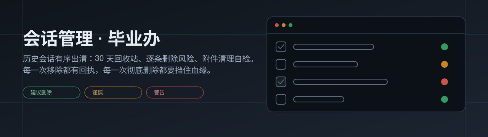
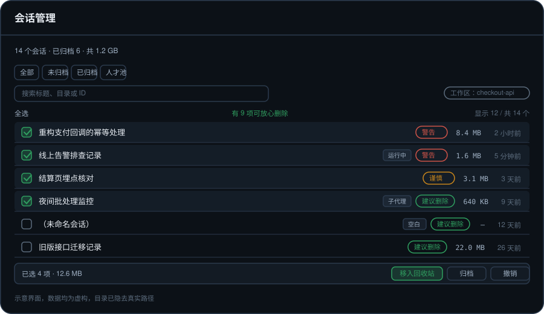
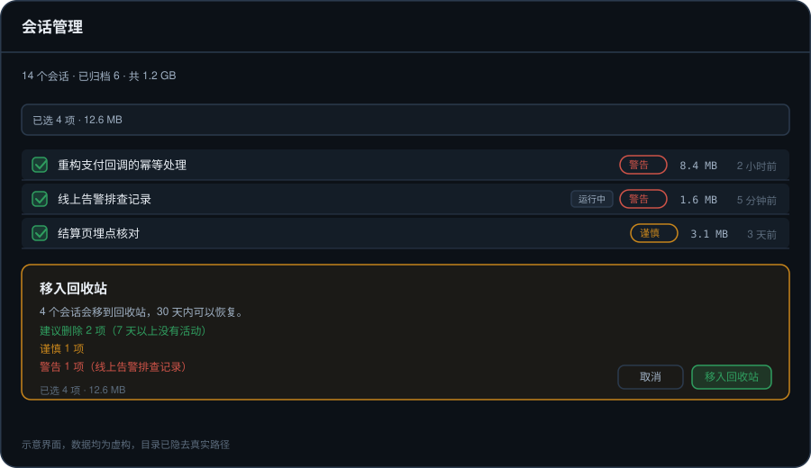
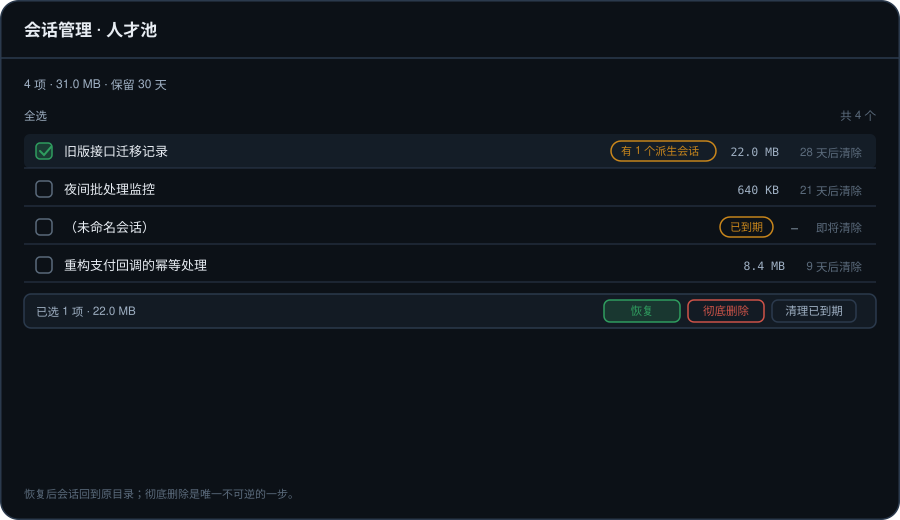

<p align="center"></p>

<p align="center">
  
  
  
  
</p>

<p align="center"><strong>简体中文</strong> · <a href="README.en.md">English</a> · <a href="CHANGELOG.md">更新日志</a> · <a href="DESIGN.md">架构设计</a></p>

---

## 痛点：历史会话的清理，一直是个靠手感的事

- **不敢删。** 几百条会话堆在那里，谁也不知道哪条还有用、哪条删了会把正在用的东西一起带走，于是磁盘一路涨到几个 G，大家选择不看。
- **删了会痛。** 真正动手时是把会话连根拔掉：图片、附件跟着失联，某个还能继续的对话突然发不出去了——而且找不回来。
- **说不清。** 三个月后有人问"上周那批会话谁删的、为什么删"，没有回执，只有一句"清理了一下"。

## 它怎么解决

这个插件把"删"做成一条**有回执的流程**，而不是一次手感操作：

1. **先判定，再动手。** 每条会话都有删除风险分级与命中理由（置顶 / 运行中 / 有派生会话 / 24 小时内活跃 / 日志过大 / 长期无活动），策略是版本化的数据文件，不是散落在代码里的魔法数字。
2. **默认不销毁。** 删除等于移入 30 天回收站，可恢复、可一键撤销；真正不可逆的那一步被单独隔离到回收站视图里。
3. **不可逆动作有门禁。** 还会被别人派生使用的会话，彻底删除会被拦下（`has-descendants`），必须显式确认；每次移动都会校验并回滚失败的情况。
4. **删完要能证明。** 附件清理独立复核"仍被引用的对象是否都还在盘上"，把证明与策略版本一起写进审计日志。

> 一句话：**让"清理历史"从手感变成有据可依的常规操作。**

### 看界面

**管理面板。** 每条会话给出风险判定与理由，右侧是占用空间与活跃时间；底部是"有 N 项可放心删除"的一键选中入口。



**确认面板。** 动手前把选择按档位拆开：建议删除几项、谨慎几项、警告具体是哪几条，然后才让你移入回收站。



**人才池（回收站）。** 倒计时、派生会话提示、恢复与彻底删除分开摆放；恢复是把会话放回原目录，彻底删除是唯一不可逆的一步。



> 以上图片为**示意图**：由 `tools/render-docs.mjs` 按真实面板结构生成，图中的会话标题、目录与数字均为虚构，路径统一写成 `~/projects/…`，不含任何真实数据。

---

## 保留一点大厂黑话（可一键关掉）

这个插件自己就是这么干的：面板标题右侧可以在**「阿里黑话」**与**「标准用语」**之间切换，选择按浏览器记忆。默认是黑话——因为需求方要的就是这个味道；不爽就点一下，操作行为完全不变。

| 黑话叫法 | 实际动作 | 安全边界 |
| --- | --- | --- |
| 毕业 / 办理毕业 | 移入回收站 | 30 天内可返聘，可一键撤销 |
| 人才池 | 回收站 | 到期自动清退，也可手动清空 |
| 返聘 | 恢复会话 | 原路径必须空闲，否则拒绝 |
| 销户 | 彻底删除 | 有派生会话会被拦下，需确认 |
| 工位盘点 | 清理未使用的附件 | 只清无引用对象，清理后自检 |
| 复盘纪要 | 审计日志 | 每条记录带策略版本 |

术语上我们是认真的：**"毕业"是可逆的，"销户"才是不可逆的**。一个词用错位置，用户就会在周五下午失去一个会话。

---

## 能力

| 能力 | 细节 |
| --- | --- |
| 批量选择 | 按标题 / 目录 / 会话 ID 搜索，按归档状态与工作区筛选，一次处理多条 |
| 删除风险分层 | 三档（警告 / 谨慎 / 建议删除），逐条给出命中理由；只有"警告"会在列表上显示角标，确认面板会点名要留意的会话 |
| 归档 | 通过宿主自己的 workspace 控制器批量归档 / 取消归档 |
| 对话文件 | 删除前会询问「同时删除在此对话中上传或创建的文件」：分别统计上传附件与会话自己写的文件，只删**没有任何其他会话引用/写过**的部分，被共用的自动保留 |
| 回收站 | 会话目录移入 `<DSH_HOME>/trash/sessions/<id>/`，条目内含原路径、移入时间、到期时间、标题与字节数；可恢复、可彻底删除、可清空过期 |
| 撤销 | 移入回收站后，状态行提供「撤销」，一次点击恢复刚才那批 |
| 附件清理 | 只回收"任何存活会话（含回收站条目）都没有引用"的对象，完成后自检并报告 `verify.ok` |
| 审计 | 每次破坏性操作追加一行到 `<DSH_HOME>/logs/session-manager.jsonl`，含策略版本与验证结论 |

### 风险分层怎么算

策略在 [`policy/risk-policy.json`](policy/risk-policy.json) 里（版本化、可校准）：

| 档位 | 命中条件 |
| --- | --- |
| **警告** | 已置顶 · 正在运行 · 有派生会话 · 24 小时内有活动 |
| **谨慎** | 24 小时到 7 天内有活动 · 日志 ≥ 20 MB |
| **建议删除** | 从未使用 · 子代理产物 · 已归档且 30 天以上无活动 · 7 天以上无活动 |

判定顺序是有意的：结构性事实（置顶/运行中/派生）无论多旧都算警告；空白与子代理产物无论多新都算建议删除；**事实缺失时不允许得出"安全"结论**，会自动降级并标记。

---

## 安全模型

- 只动 `sessionPersistence.stat(id)` 报告的路径；只有当目录名等于会话 id 时才整目录处理，否则只删那个文件。
- 运行中的会话先归档停活动、再确认空闲，然后才移动。
- **移动后校验**：条目里必须有可读日志、原路径必须已空；不满足就**移回原处**并报 `trash-verify-failed`。
- **恢复后校验**：日志确实回到原路径才算成功，否则报 `restore-verify-failed`。
- **血缘门禁**：彻底删除时仍有存活会话由它派生，会被拒绝（`has-descendants`），需显式 `force`。
- **串行化**：删除 / 恢复 / 清空 / 附件清理在宿主内互斥执行，杜绝"清理与恢复交错"这类竞态。
- 两个破坏性路由都在宿主自己的信任栅栏之后（Host/Origin + 浏览器会话 cookie）。

---

## 安装

要求：带 Web UI 的 DeepSeek Harness（插件会注册一个侧栏面板与一个同源 HTTP 路由）。

**方式一：GitHub 直装**

```bash
git clone https://github.com/yinmyu/dsh-session-manager.git
```

然后在 DSH 里打开 **Plugins → Add plugin**，选择该目录；脚本化环境等价于用 `plugin_manager` 的 `install_bundle` 指向这个绝对路径。

**方式二：作为包**

```bash
pnpm add github:yinmyu/dsh-session-manager
```

（发布到 npm 后，也可以用 `pnpm add @yinmyu/dsh-session-manager`。）

安装后**刷新页面**：客户端半部是浏览器模块。宿主半部只在应用重启后重新加载。左侧栏会出现「会话管理」。

## 配置

可选，写在 bundle 行的 `config`：

```yaml
- insert:
    - id: session-manager
      name: '@yinmyu/dsh-session-manager'
      config:
        auditLog: true          # 默认 true
        maxConcurrency: 4       # 1..8，默认 4
        trashRetentionDays: 30  # 0 表示永久保留
```

## 校准与验证

风险策略可以在真实机器上一键校准，而不改动生效版本：

```bash
curl -s -X POST -H 'content-type: application/json' --cookie "$COOKIE" \
  -d '{"op":"risk-stats"}' http://127.0.0.1:<dsh-port>/plugins/session-manager/api
```

返回直方图与逐条规则命中计数；把候选策略放进 `{"op":"risk-stats","policy":{…}}` 可以做 dry-run。

```bash
npm test   # 宿主协议/安全套件 + 客户端逻辑套件（各自独立、不碰真实数据）
```

`tools/host-smoke.mjs` 用假服务跑真实路由处理器，只写 `tools/.smoke/`；`tools/client-smoke.mjs` 用模拟 React 驱动真实面板组件，覆盖中英两种语言的文案、键盘行为、请求载荷与失败处理。

## 目录结构

```
index.js                  宿主半部：同源路由、回收站、附件清理、风险求值器
client.js                 客户端半部：侧栏入口与管理面板
policy/risk-policy.json   版本化的删除风险策略（规则、阈值、缺失事实守卫）
cordis.patch.yml          bundle 补丁，插入 Loader 行
locale/{en,zh}.json       展示标题、描述与详情文档
docs/                     详情文档、单张特性图与双语横幅
tools/                    两套测试
```

## 已知限制

- 回收站之外的"彻底删除"与附件清理不可逆；如果你之后从备份恢复会话，被清掉的附件需要重新上传。
- `~/.dsh/storages/workspace.json` 里可能残留已删会话的成员 id（宿主没有提供"从工作区移除会话"的接口，界面不可见，属无害残留）。
- 到期清理由插件激活、每小时定时器与显式清空触发；读操作不会顺手删数据，所以过期条目最长可能延迟一小时被自动清理。
- 插件详情页的图片与面板视觉需要人眼确认——自动化只能验证路径、体积与渲染输入。

## 许可

MIT，见 [LICENSE](LICENSE)。风险策略、面板文案与测试都随包提供，欢迎按自己团队的口味改阈值——改的是 JSON，不是代码。